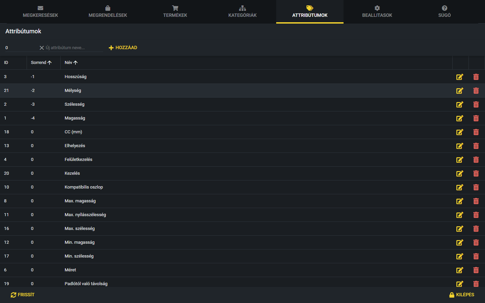
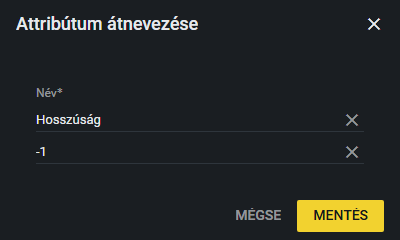
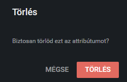

# Attribútumok

Az attribútum a variációk jellemzőinek a **típusa**. Például a „Szélesség”, a „Magasság” vagy a „Felületkezelés” attribútum. A variációnál ehhez adod meg az értéket, például „Szélesség: 40 mm”. Az attribútumok listáját az **Attribútumok** fülön kezeled.

## Mire valók?

Ha egy variációnak jellemzőt adsz meg, a jellemző típusát az itt felvett attribútumok közül választod ki. Ezért egy új jellemzőtípust először itt kell felvenni, és csak utána lehet a variációkhoz hozzárendelni. A jellemzők kezelését a [Variációk és jellemzők](variaciok.md) fejezet mutatja be.

## A lista

A táblázat oszlopai:

- **ID:** az attribútum azonosítója (a rendszer adja, nem módosítható).
- **Sorrend:** az attribútum helye a jellemzők sorrendjében.
- **Név:** az attribútum neve.
- A sor végén a sárga **ceruza** (átnevezés) és a piros **kuka** (törlés) ikon.

### Hogyan működik a sorrend?

A jellemzők egy variációnál a **Sorrend** szerint követik egymást: a kisebb szám kerül előrébb. A negatív szám is használható, ez a 0-nál is előrébb viszi az attribútumot. Ha több attribútumnak azonos a sorrendje, a nevük ábécésorrendje dönt. A listában a jelenlegi sorrend látszik, például a Hosszúság (-1), Mélység (-2), Szélesség (-3) és Magasság (-4) a 0 sorrendű attribútumok előtt áll.

Ez a sorrend az alapértelmezett. Egy termék alapértelmezett jellemzőinél (lásd: [Variációk és jellemzők](variaciok.md)) a terméken belül más sorrend is beállítható, az a terméken belül erősebb ennél.

> **Kiegészítendő:** Milyen sorrendben szeretnétek látni a jellemzőket (például méretek elöl, felületkezelés a végén)? Van-e rögzített sorrendi szabály?

## Új attribútum

A lista feletti sávban találod az új attribútum mezőit.

1. Írd be a **Sorrend** mezőbe a számot (alapértelmezés: 0).
2. Írd be az **Új attribútum neve...** mezőbe a nevet.
3. Kattints a **Hozzáad** gombra. Az „Attribútum hozzáadva” üzenet jelzi, hogy kész, a mezők kiürülnek, és az új sor megjelenik a listában.

Ha a név mező üres, a **Hozzáad** gomb nem csinál semmit.

## Átnevezés

1. Kattints a sárga **ceruza** ikonra, vagy kattints duplán az attribútum sorára.
2. Az „Attribútum átnevezése” ablakban írd át a **Nevet** (kötelező). Az alatta lévő, címke nélküli szám mező a **Sorrend**, azt is itt módosíthatod.
3. Kattints a **Mentés** gombra. A **Mégse** nem ment semmit.

Az átnevezés a már meglévő variációkon is megváltozik, mert azok az attribútumra hivatkoznak, nem a nevére.

## Törlés

1. Kattints a piros **kuka** ikonra.
2. A megerősítő ablakban kattints a piros **Törlés** gombra.

**Figyelem:** a törlés **végleges**, és az attribútum minden használata is törlődik. Az adatbázis szerkezete miatt a törölt attribútumhoz tartozó értékek **minden variációról** eltűnnek (például az összes „Felületkezelés” érték), és az is törlődik a termékek alapértelmezett jellemzőiből. A rendszer nem szól előre, hány variációt érint. Ezért csak olyan attribútumot törölj, amit biztosan nem használsz.

> **Kiegészítendő:** Szoktatok-e attribútumot törölni? Ha igen, milyen ellenőrzés után (például hogy melyik termékeknél használják)?
