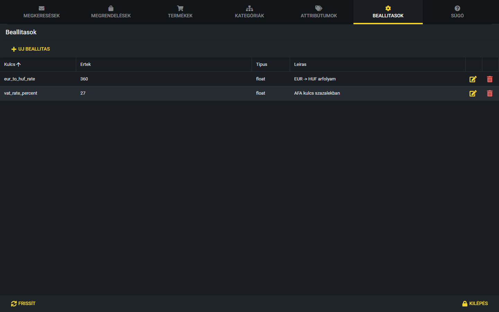
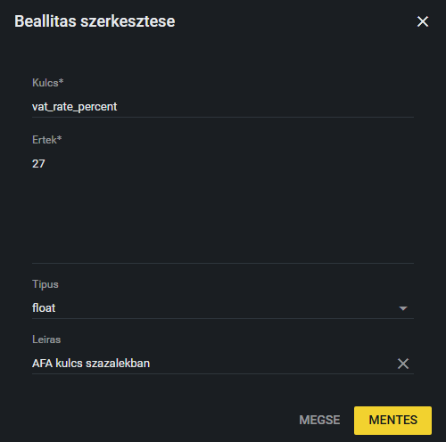

# Beállítások

A Beállítások fülön azok az értékek vannak, amelyeket a weboldal működéséhez használ a rendszer: például az árfolyam, az ÁFA kulcs és a szállítási tájékoztató szövege. Ezeket nem kell a programozóval módosíttatni, itt át tudod írni. A beállítások azonnal hatnak, ezért óvatosan módosítsd őket.

## A beállítások

A táblázat oszlopai:

- **Kulcs:** a beállítás neve, amellyel a rendszer megtalálja (például `eur_to_huf_rate`).
- **Ertek** (Érték): a beállítás értéke.
- **Tipus** (Típus): az érték fajtája (lásd lejjebb).
- **Leiras** (Leírás): rövid magyarázat arról, mire való.
- A sor végén a sárga **ceruza** (szerkesztés) és a piros **kuka** (törlés) ikon.

### Eur–forint árfolyam (`eur_to_huf_rate`)

A termékek árai a rendszerben **euróban, nettó** összegként vannak megadva. A weboldal és a kosár ebből ennek az árfolyamnak a szorzatával számolja ki a **forintos** árat. Például 360-as árfolyamnál egy 10 EUR nettó árú termék nettó ára 3600 Ft. Ha az érték hiányzik vagy nem pozitív szám, a rendszer 400-at használ.

> **Kiegészítendő:** Ki frissíti az árfolyamot, milyen gyakran (például havonta, vagy ha jelentősen elmozdul), és honnan veszitek az aktuális értéket?

### ÁFA kulcs (`vat_rate_percent`)

Az ÁFA kulcs százalékban, például 27. A weboldal ebből számolja a bruttó árat és az ÁFA összegét az árakon és a kosárban. Ha az érték hiányzik vagy negatív, a rendszer 27-et használ.

### Szállítási információ (`delivery_info`)

A megrendelés (pénztár) oldalon a „Szállítási információk” dobozban megjelenő szöveg. Minden **sor** külön, pipás listaelemként jelenik meg, ezért a szöveget sorokba tördelve írd be (a mezőben Entert lehet ütni). Ha az érték üres, vagy a beállítás nem létezik, a doboz nem jelenik meg.

> **Kiegészítendő:** Ki és mikor módosítja a szállítási információ szövegét? Van-e jóváhagyott szöveg, amelyet használni kell?

## Szerkesztés

1. Kattints a sárga **ceruza** ikonra, vagy kattints duplán a beállítás sorára.
2. A „Beallitas szerkesztese” (Beállítás szerkesztése) ablakban írd át az **Ertek** (érték) mezőt. A **Kulcs** nem módosítható, csak olvasható. A **Tipus** és a **Leiras** is átírható, de ezt általában nem kell.
3. Kattints a **Mentes** (Mentés) gombra. A „Beallitas frissitve” üzenet jelzi, hogy kész. A **Megse** (Mégse) nem ment semmit.

**Figyelem:** az árfolyam vagy az ÁFA kulcs módosítása a mentés pillanatától **azonnal minden forintárat érint** a weboldalon és a kosárban. Tizedesvesszőként pontot használj (például 392.5), és ellenőrizd az értéket, mielőtt mentesz.

A **Tipus** mező azt mondja meg, hogyan értelmezi a rendszer az értéket: `float` (tizedes szám), `int` (egész szám), `bool` (igen/nem), `json` (strukturált adat) vagy `string` (szöveg). Meglévő beállításnál ne változtasd.

## Új beállítás és törlés

Az **Uj beallitas** (Új beállítás) gombbal lehet új kulcsot felvenni, a kuka ikonnal pedig törölni egyet. A weboldal csak azokat a beállításokat használja, amelyeket a kód ismer (a fent leírtak), ezért egy új, saját kulcs önmagában semmit nem változtat. Ha törölsz egy beállítást, a megerősítés után az végleg törlődik, és az árfolyam, illetve az ÁFA kulcs a fent írt alapértékre áll vissza, a szállítási információ pedig eltűnik az oldalról. Ezért ne töröld őket.

