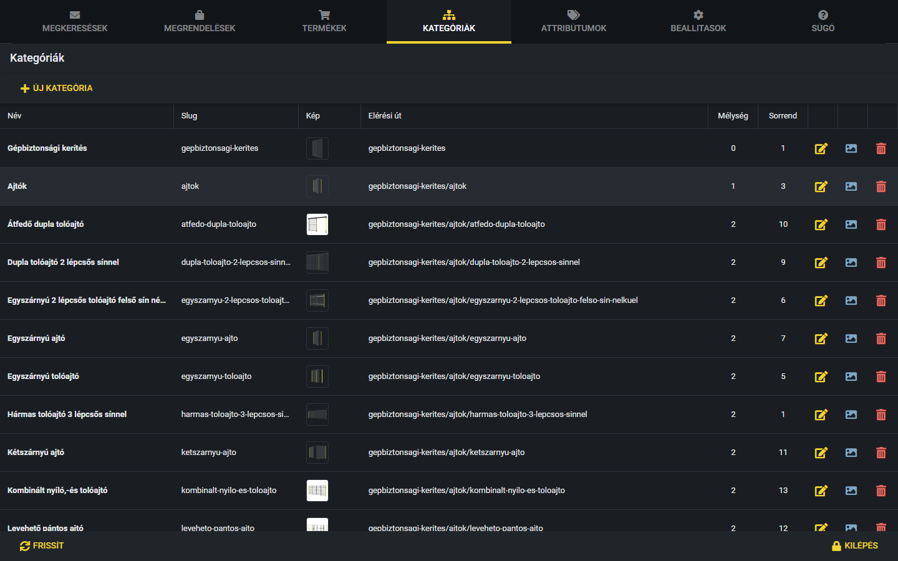
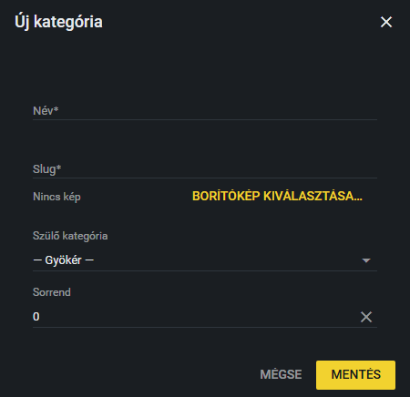
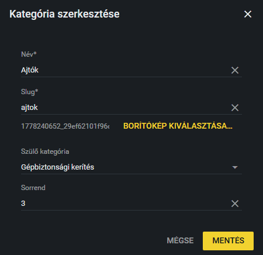

# Kategóriák

A termékek kategóriákba vannak rendezve, a kategóriák pedig fát alkotnak: egy főkategória alatt alkategóriák lehetnek, azok alatt is. A termékek mindig a fa legalsó szintjén lévő (alkategória nélküli) kategóriába kerülnek. A kategóriákat a **Kategóriák** fülön kezeled.

## A kategóriafa

A táblázat a fa sorait mutatja a fa sorrendjében. Oszlopok:

- **Név:** a kategória neve.
- **Slug:** a kategória webcímének a része (kisbetű, szám, kötőjel). A termékeknél is találkozhattál vele: [Új termék felvétele](uj-termek.md).
- **Kép:** a kategória borítóképének kicsinyített képe, vagy a „Nincs kép” felirat.
- **Elérési út:** a kategória teljes útvonala a főkategóriától kezdve, például `gepbiztonsagi-kerites/ajtok`.
- **Mélység:** hányadik szinten van a kategória. A 0 a főkategória, az 1 az alkategória, a 2 az az alatti szint és így tovább.
- **Sorrend:** a kategóriák egymás közötti sorrendje.
- A sor végén három ikon: sárga **ceruza** (szerkesztés), kék **kép** (borítókép feltöltése), piros **kuka** (törlés).

## Új kategória

1. Kattints az **Új kategória** gombra.
2. Írd be a kategória **Nevét** (kötelező).
3. A **Slug** (kötelező) mezőt a rendszer a névből automatikusan kitölti. Ha magad átírod, abbahagyja a kitöltést.
4. Ha szeretnél borítóképet, kattints a **Borítókép kiválasztása…** gombra, és válaszd ki a fájlt. Az előnézet megjelenik az ablakban. A kép a **Mentés** gombra kattintva töltődik fel.
5. A **Szülő kategória** listában válaszd ki, melyik kategória alá kerüljön az új. A „— Gyökér —” azt jelenti, hogy főkategória lesz. Az alkategóriák a listában kötőjelekkel beljebb vannak húzva.
6. A **Sorrend** mezőbe számot írhatsz. Alapértelmezés: 0.
7. Kattints a **Mentés** gombra. A **Mégse** semmit nem hoz létre.

A mentéskor a rendszer ellenőrzi, hogy:

- a név és a slug ki van-e töltve,
- a slug még szabad-e (két kategóriának nem lehet ugyanaz a slugja),
- a szülő kategóriához nem tartoznak-e már termékek. Ha igen, a mentés hibaüzenettel leáll: előbb a termékeket át kell helyezni a levél kategóriába (lásd: [Több termék áthelyezése](termekek-athelyezese.md)).

## Kategória szerkesztése

1. Kattints a sárga **ceruza** ikonra a sor végén, vagy kattints duplán a kategória sorára.
2. Módosítsd a **Nevet**, a **Slugot**, a **Szülő kategóriát** vagy a **Sorrendet**. A **Szülő kategória** listában a kategória saját maga nem szerepel, mert nem lehet önmaga szülője.
3. Kattints a **Mentés** gombra.

**Vigyázat:** a slug módosítása megváltoztatja a kategória (és a benne lévő termékek) webcímét. A régi címen a kategória ezután nem lesz elérhető.

> **Kiegészítendő:** Van-e szabály a kategóriák elnevezésére, sorrendjére és a fa mélységére? Ki dönt új kategória létrehozásáról?

## Borítókép

A borítókép a kategória képe a weboldalon. Két módon adhatsz meg egyet:

- A **Szerkesztés** ablakban a **Borítókép kiválasztása…** gombbal. Ilyenkor a kép a **Mentés** gombbal töltődik fel.
- Gyorsabban: kattints a sor végén a kék **kép** ikonra, és válaszd ki a fájlt. Ilyenkor a kép **azonnal feltöltődik**, a „Kép feltöltve” üzenet jelzi.

Támogatott formátumok: JPG, PNG, WebP és GIF. A feltöltött kép lecseréli az előzőt.

## Törlés

1. Kattints a piros **kuka** ikonra.
2. A megerősítő ablakban a piros **Törlés** gombra kattintva törlődik a kategória. A **Mégse** nem csinál semmit.

**Figyelem:** a rendszer nem engedi törölni azt a kategóriát,

- amelynek **alkategóriái** vannak („Nem törölhető: a kategóriának vannak alkategóriái.”), vagy
- amelyhez **termékek** tartoznak („Nem törölhető: a kategóriához termékek tartoznak.”).

Ilyenkor előbb töröld az alkategóriákat, illetve helyezd át a termékeket másik kategóriába ([Több termék áthelyezése](termekek-athelyezese.md)), és csak utána töröld a kategóriát. Üres kategória törlése végleges.

## A weboldal címei

A kategória létrehozása, módosítása és törlése után a weboldal címei (a kategóriák webcímei) **automatikusan frissülnek**. Ezzel nincs teendőd.
