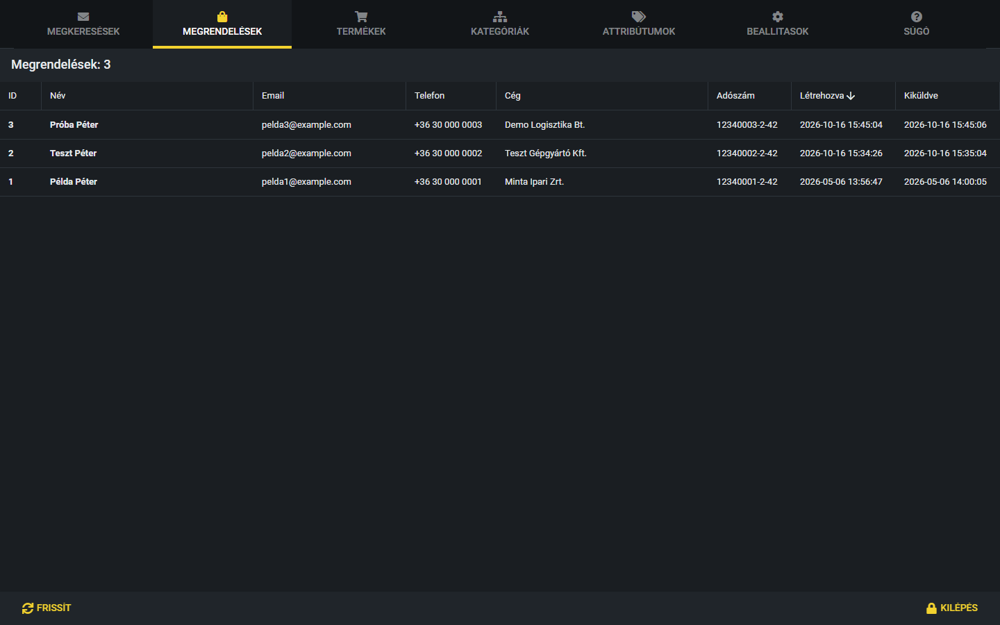
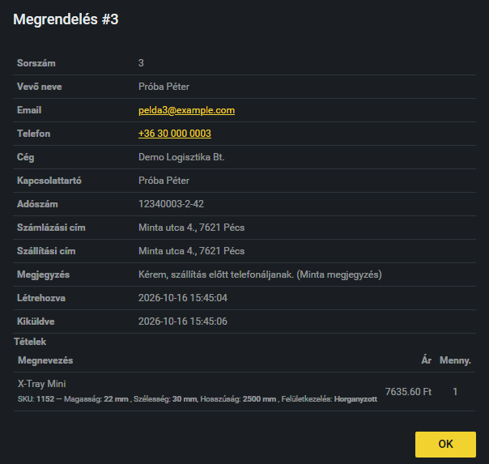

# Megrendelések kezelése

Itt látod a webshopban leadott megrendeléseket. A legújabb van legfelül, a fül címében a megrendelések száma szerepel.

## A lista

A táblázat oszlopai: **ID** (sorszám), **Név**, **Email**, **Telefon**, **Cég**, **Adószám**, **Létrehozva** (a rendelés leadásának ideje) és **Kiküldve** (mikor ment ki a rendelésről szóló belső értesítő e-mail a cég postafiókjába, az info@jbx.hu címre; kötőjel, ha még nem).

## Hogyan nézem meg egy rendelés részleteit?

1. Kattints a rendelés sorára.
2. Megnyílik a „Megrendelés” ablak a vevő adataival: név, email, telefon, cég, kapcsolattartó, adószám, számlázási és szállítási cím, megjegyzés, létrehozás ideje.
3. Alul a **Tételek** táblázat mutatja a megrendelt termékeket: megnevezés, alatta kisebb betűvel az SKU és a jellemzők (például méret, felületkezelés), az ár (Ft-ban) és a mennyiség.
4. A **Kiküldve** sorban az áll, mikor ment ki a rendelésről a belső értesítő e-mail az info@jbx.hu címre. Ez nem a vevőnek szóló levél. Ha még nem ment ki, pirosan ez olvasható: „Küldésre vár”.
5. Az **OK** gombbal zárd be az ablakot.

A megrendelések az adminban csak megtekinthetők: nem lehet őket módosítani vagy törölni.

> **Kiegészítendő:** Hogyan zajlik egy rendelés feldolgozása a webshopon kívül (ki veszi át, számlázás, szállítás, vevő értesítése)? Kap-e a vevő visszaigazolást, és ha igen, ki küldi? Mit kell tenni, ha egy rendelésnél sokáig „Küldésre vár” áll a Kiküldve mező (az értesítő nem ment ki az info@jbx.hu címre)?
