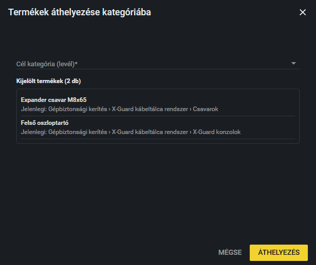

# Több termék áthelyezése

Ha több terméket kell egy másik kategóriába tenni, nem kell egyesével szerkesztened őket: kijelölheted őket a Termékek listában, és egyszerre átteheted a célkategóriába.

## Hogyan helyezek át több terméket?

1. Nyisd meg a **Termékek** fület.
2. Jelöld ki az áthelyezendő termékeket a listában. Egy termék kijelöléséhez kattints a sorára. Több termékhez tartsd lenyomva a **Ctrl** billentyűt, és úgy kattints az újabb sorokra; egymás utáni sorokat a **Shift** billentyűvel jelölhetsz ki: kattints az elsőre, majd Shift lenyomva az utolsóra. Ctrl nélkül a sima kattintás mindig csak az éppen kattintott sort jelöli ki. A kijelölt sorok kiemelve látszanak. (Duplán ne kattints, mert az megnyitja a termék szerkesztőjét.)
3. Kattints a lista tetején a **Kijelöltek áthelyezése** gombra. Ha nem jelöltél ki egyetlen terméket sem, a „Jelölj ki legalább egy terméket az áthelyezéshez.” figyelmeztetést kapod.
4. Megnyílik a „Termékek áthelyezése kategóriába” ablak. A **Cél kategória (levél)** listából válaszd ki, hová kerüljenek a termékek. Gépeléssel szűkítheted a listát.
5. Az ablak alján a **Kijelölt termékek** listájában még egyszer ellenőrizheted, hogy melyik termék most melyik kategóriában van.
6. Kattints az **Áthelyezés** gombra. A „… termék áthelyezve” üzenet jelzi a sikert, és a lista frissül. A **Mégse** semmit nem változtat.

## Mire figyelj?

- Célnak csak **levél kategória** választható, vagyis olyan, amelynek nincs alkategóriája. Ezért a listában csak ilyenek szerepelnek.
- Az áthelyezés azonnal érvényes, és minden kijelölt termékre vonatkozik. Mentés gomb nincs.
- A kategóriákról és azok szerkezetéről itt olvashatsz: [Kategóriák](kategoriak.md).

Egyetlen termék áthelyezéséhez egyszerűbb a termék szerkesztője, ott a **Kategória áthelyezése** mezőt kell használni. Lásd: [Termék szerkesztése](termek-szerkesztese.md).

> **Kiegészítendő:** Milyen esetben szoktatok termékeket egyszerre áthelyezni (például kategória átszervezése után)? Kell-e utána valamit ellenőrizni a weboldalon?
