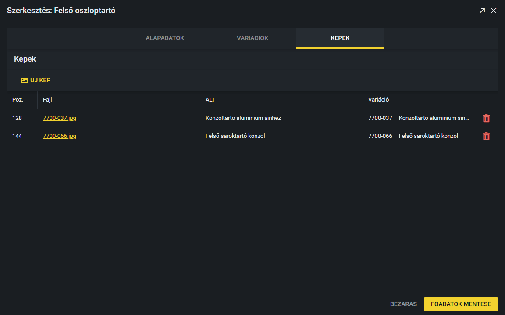
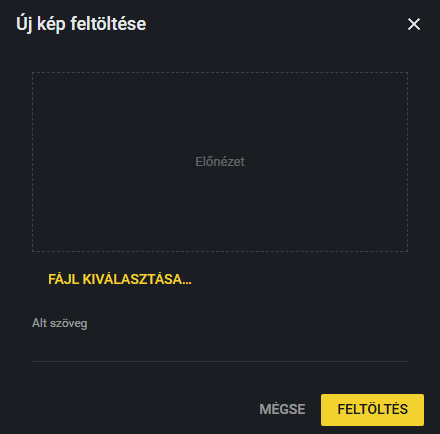

# Termékképek

A termékek képeit a termék szerkesztő ablakának **Kepek** (Képek) fülén kezeled. Itt tölthetsz fel új képet, átírhatod a leírását vagy a sorrendjét, és törölhetsz is.

Az ablak megnyitása: Termékek fül, majd ceruza ikon vagy dupla kattintás a soron. Részletek: [Termék szerkesztése](termek-szerkesztese.md).

## A képek listája

A lista a termékhez feltöltött képeket mutatja. Oszlopok:

- **Poz.:** a kép sorszáma, a sorrendet ez adja.
- **Fajl** (Fájl): a kép fájlneve. Rákattintva új lapon megnyílik a kép.
- **ALT:** a kép szöveges leírása (lásd lejjebb).
- **Variáció:** melyik variációhoz tartozik a kép. **Minden variáció** esetén a kép a termék összes variációjánál látszik; egyébként a variáció cikkszáma és neve áll itt (például „1152 – X-Tray Mini”).
- A sor végén a piros **kuka** ikon törli a képet.

### Hogyan módosítom a képek adatait?

1. Kattints duplán a módosítandó cellára (**Poz.**, **ALT** vagy **Variáció**).
2. A **Poz.** és az **ALT** cellába írd be az új értéket. A **Variáció** cellánál egy lista nyílik: válaszd ki a variációt, vagy a **Minden variáció** sort.
3. Ha kilépsz a cellából, a módosítás **azonnal elmentődik**, külön mentés gomb nincs. A „Kep mentve” üzenet jelzi. A **Főadatok mentése** gombot nem kell megnyomnod.

A **Fajl** cella is átírható, de ezt ne tedd: a fájlnevet átírva a kép nem találja a fájlt, és eltűnik a weboldalról.

### Hogyan rendelek egy képet egy variációhoz?

1. Kattints duplán a kép **Variáció** cellájára.
2. A listában a termék variációi szerepelnek (cikkszám és név), legfelül a **Minden variáció**. Válaszd ki a megfelelőt.
3. Kattints a cellán kívülre: a hozzárendelés azonnal elmentődik.

A listában mindig az adott termék aktuális variációi vannak: ha a **Variációk** fülön új variációt veszel fel, az is megjelenik benne. Másik termék variációjához a kép nem rendelhető. Ha a mentés nem sikerül, hibaüzenetet kapsz, és a cella visszaáll a korábbi értékre.

Ha egy képnél a **⚠ Nem létező variáció** felirat látszik, a kép egy már nem létező variációhoz volt kötve. Válaszd ki a helyes variációt, vagy a **Minden variáció** sort.

### Melyik kép látszik a weboldalon?

Amikor a látogató kiválaszt egy variációt a termékoldalon, a **Minden variáció** képek és az adott variációhoz rendelt képek látszanak, a **Poz.** sorrendjében. Ha egy variációhoz így egyetlen kép sem jut, a termék összes képe megjelenik, hogy ne maradjon üresen a galéria.

> **Kiegészítendő:** Szoktatok-e képet konkrét variációhoz rendelni (például színenként vagy méretenként külön kép), vagy a legtöbb kép minden variációhoz tartozik?

## Mi az ALT szöveg?

Az ALT a kép rövid szöveges leírása, például „X-Tray Mini kábeltálca, 40 mm”. Akkor jelenik meg, ha a kép nem tölt be, és ezt olvassák fel a képernyőolvasók a gyengénlátóknak. A keresők is ebből értik meg, mi látszik a képen. Érdemes minden képhez megadni, de nem kötelező.

> **Kiegészítendő:** Van-e szabály az ALT szöveg formájára (például a termék neve és a nézet: „X-Tray Mini, oldalnézet”)?

## Új kép feltöltése

1. A **Kepek** fülön kattints az **Uj kep** (Új kép) gombra.
2. Kattints a **Fájl kiválasztása…** gombra, és válaszd ki a képet a gépedről. A kiválasztott kép előnézete megjelenik az ablakban.
3. Ha szeretnéd, írd be az **Alt szöveget**.
4. Kattints a **Feltöltés** gombra. Sikeres feltöltés után a „Kép feltöltve” üzenet jelenik meg, és a kép bekerül a listába. A **Mégse** semmit nem tölt fel.

Néhány tudnivaló:

- Támogatott formátumok: **JPG, PNG, WebP és GIF**. Más típusú fájlt a rendszer elutasít.
- Ha nem választasz fájlt, a „Kérjük válasszon képfájlt.” hibaüzenetet kapod.
- Az új kép a lista végére kerül (a legnagyobb **Poz.** utáni sorszámot kapja), és **Minden variáció** beállítással jön létre. Ha egy konkrét variációhoz tartozik, feltöltés után állítsd be a **Variáció** cellában (lásd fent).
- A rendszer a fájlnevet átnevezi egy véletlenszerű névre, ezért az eredeti fájlnév nem marad meg.

> **Kiegészítendő:** Mekkora legyen a feltöltött kép (felbontás, fájlméret)? A kód nem korlátozza, de a szerver beállításai igen, és a túl nagy kép lassítja a weboldalt.

## Hogyan törlök egy képet?

1. Kattints a kép sorának végén a piros **kuka** ikonra.
2. A megerősítő ablakban kattints a piros **Törlés** gombra. A „Kep torolve” üzenet jelzi, hogy kész.

A törlés azonnali és végleges, a kép kikerül a termékből.
