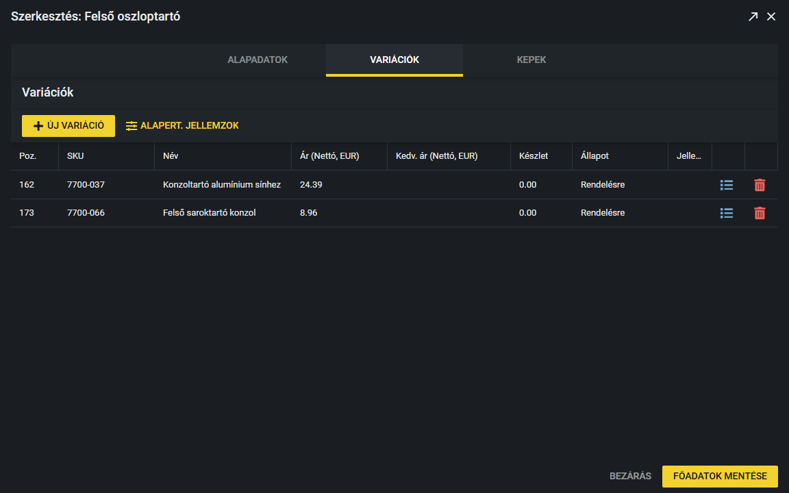
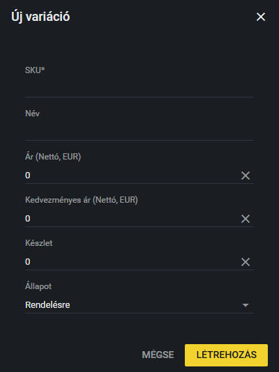
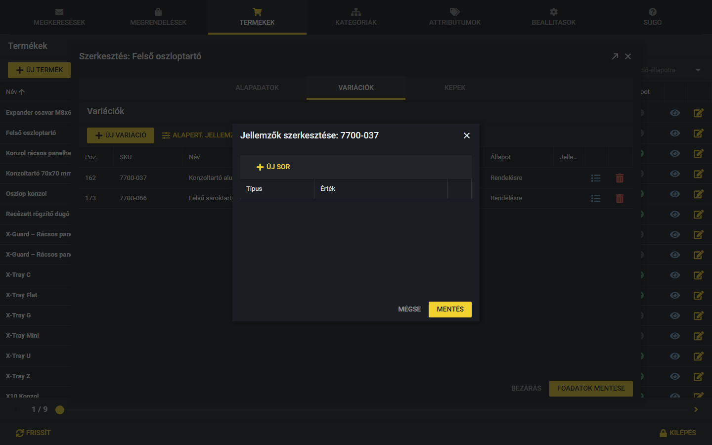
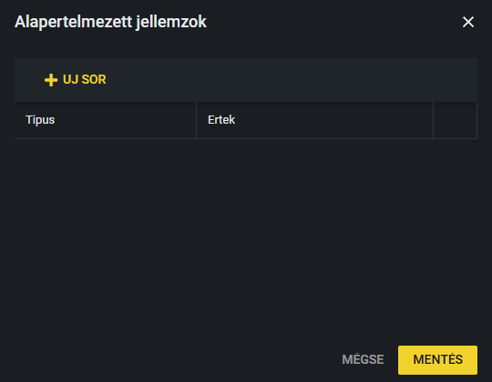

# Variációk és jellemzők

A **termék** egy gyűjtő (például „X-Tray Mini”). A **variáció** a konkrét, rendelhető tétel: saját cikkszáma (SKU), ára és készletállapota van. Egy termékhez több variáció tartozhat. A **jellemző** a variáció tulajdonsága, például „Szélesség: 40 mm”. A jellemzők típusai az Attribútumok fülön vannak.

A variációkat a termék szerkesztő ablakának **Variációk** fülén kezeled: Termékek fül, majd ceruza ikon vagy dupla kattintás a soron.

## A variációk listája

Oszlopok: **Poz.** (sorrend), **SKU**, **Név**, **Ár (Nettó, EUR)**, **Kedv. ár (Nettó, EUR)** (kedvezményes ár), **Készlet**, **Állapot** és **Jellemzők** (az adott variáció jellemzői egy sorban).

### Hogyan módosítok egy variációt?

1. Kattints duplán a módosítandó cellára (Poz., SKU, Név, ár, Készlet vagy Állapot).
2. Írd át az értéket, az Állapotnál válassz a listából.
3. Ha kilépsz a cellából, a módosítás **azonnal elmentődik**, külön mentés gomb nincs. A „Variáció elmentve” üzenet jelzi.

### Készletállapotok

- **Raktáron**
- **Rendelésre**
- **Ajánlatkérés**
- **Inaktív**: az inaktív variáció a weboldalon nem látszik. A másik három állapotú variáció a weboldalon megjelenik.

> **Kiegészítendő:** Mikor melyik készletállapotot használjátok (mi számít „Raktáron”, mikor „Rendelésre”, mikor „Ajánlatkérés”)? A Készlet számát kézzel írjátok át, vagy más rendszerből jön?

### Hogyan törlök egy variációt?

Kattints a sor végén a piros **kuka** ikonra, majd a megerősítő ablakban a piros **Törlés** gombra.

## Hogyan veszek fel új variációt?

1. A Variációk fülön kattints az **Új variáció** gombra.
2. Add meg az **SKU**-t (kötelező), a **Nevet**, az **Árat** és a **Kedvezményes árat** (nettó, EUR; a 0 azt jelenti, hogy nincs kedvezmény), a **Készletet**, és válaszd ki az **Állapotot** (alapértelmezés: Rendelésre).
3. Kattints a **Létrehozás** gombra. A **Mégse** semmit nem hoz létre.
4. Ha a terméknek vannak alapértelmezett jellemzői (lásd lejjebb), azok automatikusan rákerülnek az új variációra, és a jellemzők szerkesztő ablaka rögtön megnyílik, hogy kitöltsd az értékeket.

## Hogyan szerkesztem egy variáció jellemzőit?

1. A variáció sorában kattints a kék **lista** ikonra.
2. Megnyílik a „Jellemzők szerkesztése” ablak. Az **Új sor** gombbal új sort adhatsz hozzá.
3. A **Típus** cellában (duplán rákattintva) válaszd ki a jellemző típusát a listából, az **Érték** cellába írd be az értéket (például 40 mm).
4. A sor végén a piros **kuka** ikonnal törölheted a sort (ez csak az ablakon belül töröl, amíg el nem mented).
5. Kattints a **Mentés** gombra. Ha valamelyik sorból hiányzik a típus vagy az érték, a rendszer hibát jelez, és nem ment. A **Mégse** a módosításokat eldobja.

## Alapértelmezett jellemzők

Az **Alapert. jellemzok** (alapértelmezett jellemzők) gomb a termék szintjén határozza meg, hogy milyen jellemzőtípusok tartozzanak a termék variációihoz. A gomb a Variációk fül tetején van.

1. Kattints az **Alapert. jellemzok** gombra.
2. Az **Uj sor** (új sor) gombbal adj hozzá sorokat: a **Tipus** (típus) cellában válaszd ki a jellemzőt, az **Ertek** (érték) cellába pedig az alapértelmezett értéket írhatod (üresen is hagyhatod).
3. A kukával törölhetsz sort, a **Mentés** gombbal mentheted az ablakot.

**Új variációnál** ezek a típusok az alapértékükkel automatikusan rákerülnek az új variációra. A már meglévő variációkat ez nem változtatja meg.

> **Kiegészítendő:** Milyen jellemzőket szoktatok megadni az egyes terméktípusoknál (például X-Tray: magasság, szélesség, hosszúság, felületkezelés)? Van-e kötelező minimum jellemzőkészlet egy termékhez?
