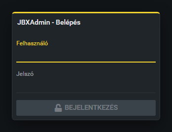
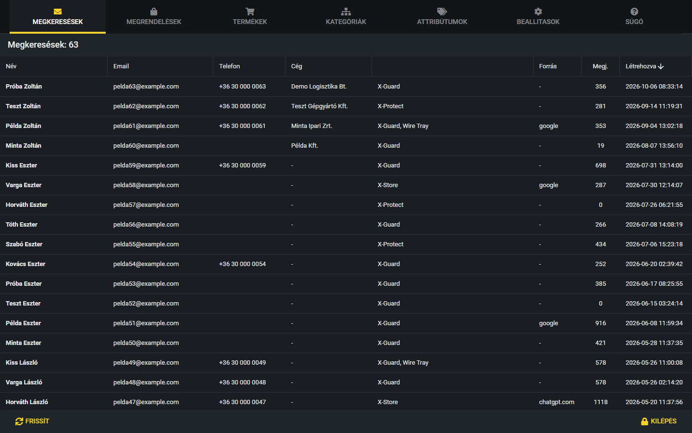
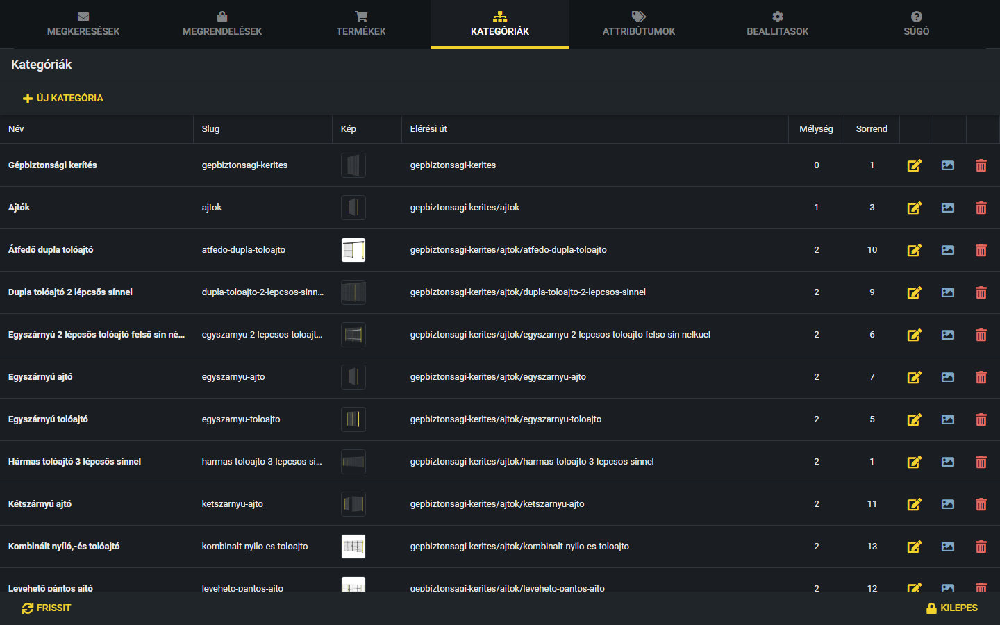

# Első lépések

Ez a kézikönyv az admin felület használatát mutatja be lépésről lépésre. Itt az alapokat találod: hogyan lépj be, mit jelentenek a fülek, az ikonok és a gombok.

## Belépés

Az admin felület a böngészőben nyílik meg. Add meg a felhasználóneved és a jelszavad, majd
kattints a **Bejelentkezés** gombra (vagy nyomj Entert a jelszó mezőben).

## A főablak

Belépés után felül láthatod a füleket (Megkeresések, Megrendelések, Termékek, Kategóriák,
Attribútumok, Beállítások, Súgó). Alul a **Frissít** gomb újratölti az aktuális fül adatait,
a **Kilépés** gomb kijelentkeztet (előtte rákérdez, hogy biztosan ki akarsz-e lépni).

## A fülek

- **Megkeresések:** a weboldalon keresztül érkezett ajánlatkérések listája. Részletek: [Megkeresések kezelése](megkeresesek.md).
- **Megrendelések:** a webshopban leadott rendelések listája. Részletek: [Megrendelések kezelése](megrendelesek.md).
- **Termékek:** a webshop termékei. Új termék felvétele: [Új termék felvétele](uj-termek.md); meglévő módosítása: [Termék szerkesztése](termek-szerkesztese.md); a konkrét, rendelhető változatok kezelése: [Variációk és jellemzők](variaciok.md).
- **Kategóriák:** a termékkategóriák fája, amelybe a termékek tartoznak.
- **Attribútumok:** a jellemzők típusainak listája (például „Szélesség”).
- **Beállítások:** az oldal kulcs–érték beállításai.
- **Súgó:** ez a kézikönyv.

## Ikonok a táblázatokban

A táblázatok sorainak végén színes ikonok vannak. Mindegyik külön oszlop, a rájuk kattintva indul a művelet:

- **sárga ceruza:** szerkesztés
- **kék szem:** előnézet
- **kék kép:** kép / borítókép
- **kék lista:** jellemzők
- **piros kuka:** törlés

A kuka mindig rákérdez, mielőtt bármit töröl. A megerősítő ablakban a piros **Törlés** gomb töröl, a **Mégse** nem csinál semmit.

## Dupla kattintás

A Termékek, Kategóriák, Attribútumok és Beállítások táblázatban egy sorra duplán kattintva megnyílik a szerkesztő, nem kell az ikont keresned. Az ikon- és az Állapot oszlopra kattintva nem ez történik, azoknak saját funkciójuk van.

## Gombok az ablakokban

Az ablakok alján a gombok mindig ugyanúgy vannak elrendezve:

- **Balra** a szürke gomb (**Mégse**, **Bezárás**, **Nem**): bezárja az ablakot, semmit nem ment.
- **Jobbra** a sárga fő gomb (például **Mentés**, **Létrehozás**, **OK**, **Igen**): végrehajtja vagy elmenti, amit megadtál.
- A piros **Törlés** gomb csak törlés megerősítésénél szerepel, és **véglegesen** töröl.
