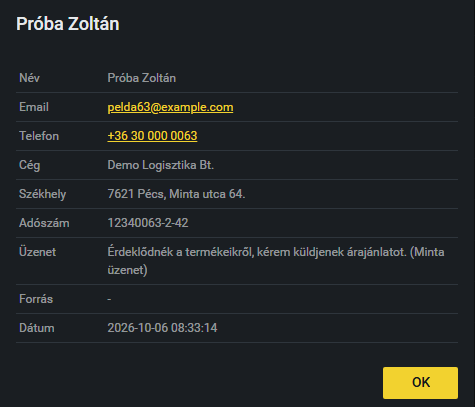

# Megkeresések kezelése

Itt látod a weboldal ajánlatkérő űrlapján keresztül érkezett megkereséseket. A legújabb van legfelül.

## A lista

A fül címében látod, hány megkeresés van összesen (például „Megkeresések: 63”). A táblázat oszlopai:

- **Név, Email, Telefon, Cég:** a beküldő adatai (ha nem adott meg céget, kötőjel áll).
- **Fejléc nélküli oszlop:** a termékcsalád, amelyik érdekli a beküldőt (például X-Guard, X-Store).
- **Forrás:** honnan érkezett a látogató (például google); kötőjel, ha nem ismert.
- **Megj.:** az üzenet hossza karakterben (a 0 azt jelenti, hogy nem írt üzenetet).
- **Létrehozva:** mikor érkezett a megkeresés.

## Hogyan nyitok meg egy megkeresést?

1. Kattints a megkeresés sorára.
2. Megnyílik egy ablak a teljes tartalommal: név, email, telefon, cég, székhely, adószám, üzenet, forrás és dátum.
3. Az email címre kattintva elindul az email-küldés, a telefonszámra kattintva a hívás (ha az eszközöd támogatja).
4. Ha a beküldő fájlt is csatolt, a **Fájlok** sorban a fájlnévre kattintva új lapon megnyílik vagy letölthető.
5. Az **OK** gombbal zárd be az ablakot.

A megkeresések az adminban csak megtekinthetők: nem lehet őket szerkeszteni, törölni vagy lezárni.

> **Kiegészítendő:** Mi a teendő egy új megkereséssel (ki válaszol rá, hol rögzítitek, mennyi időn belül kell reagálni)? A felületen nincs „lekezelve” jelölés, ezért honnan látszik, hogy egy megkereséssel már foglalkoztatok?
