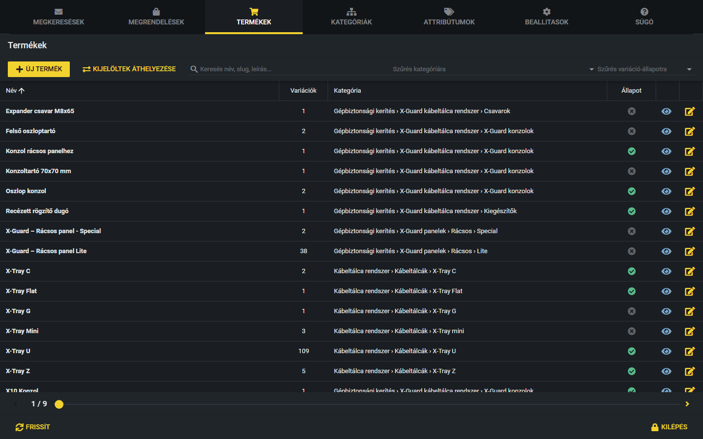
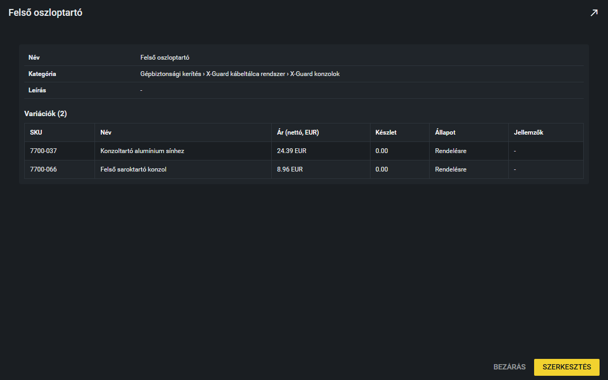
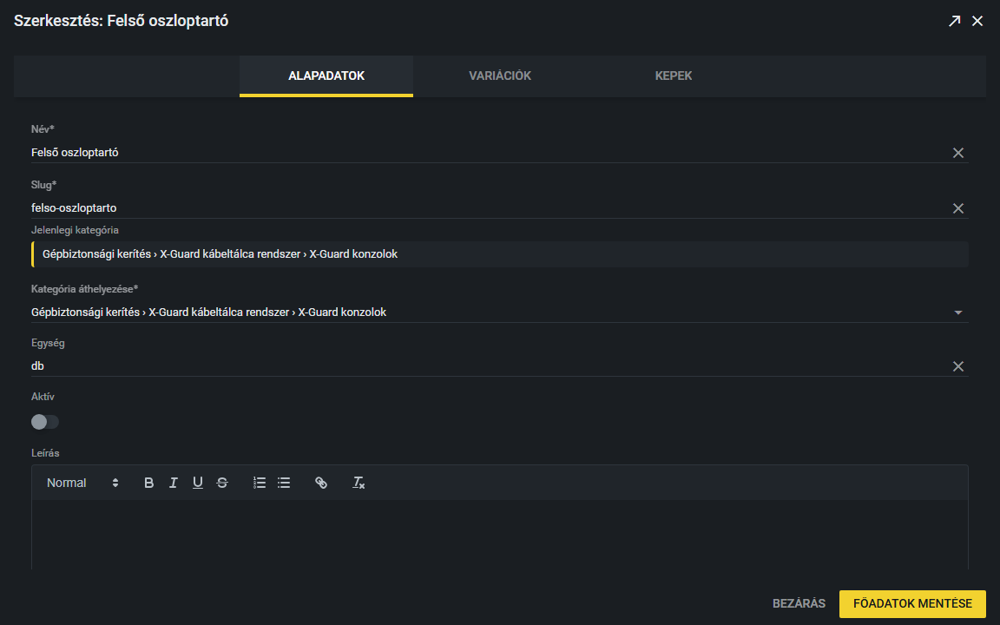

# Termék szerkesztése

A Termékek fülön látod az összes terméket. Innen tudod megnézni, módosítani, ki- és bekapcsolni őket.

## A terméklista

A táblázatban a termék **Neve**, a **Variációk** száma, a **Kategória** útvonala és az **Állapot** látszik. Alul lapozni tudsz.

A lista tetején kereshetsz és szűrhetsz:

- **Keresés:** a név, a slug és a leírás alapján keres, gépelés közben szűri a listát.
- **Szűrés kategóriára:** válassz egy kategóriát, és csak a hozzá tartozó termékek látszanak.
- **Szűrés variáció-állapotra:** azokat a termékeket mutatja, amelyeknek van legalább egy Raktáron / Rendelésre / Ajánlatkérés / Inaktív állapotú variációja.
- A szűrők egymással kombinálhatók; a keresés vagy szűrés után a lista az első oldalról indul.

## Hogyan kapcsolok ki vagy be egy terméket?

Az **Állapot** oszlopban zöld pipa = aktív (látszik a weboldalon), szürke X = inaktív (nem látszik). Rákattintva **azonnal vált, megerősítés nélkül**, és egy kis üzenet jelzi: „Termék aktiválva” vagy „Termék inaktiválva”. Óvatosan kattints!

## Előnézet

A kék **szem** ikonra kattintva megnyílik a termék összefoglalója: név, kategória, leírás és a variációk táblázata (SKU, név, ár, készlet, állapot, jellemzők). Itt csak nézni lehet. A **Szerkesztés** gomb átvisz a szerkesztőbe, a **Bezárás** bezárja az ablakot.

## Hogyan szerkesztem a termék alapadatait?

1. Kattints a sárga **ceruza** ikonra a sor végén, vagy kattints duplán a termék sorára (az ikonokon és az Állapot oszlopon kívül bárhol).
2. A szerkesztő ablakban három fül van: **Alapadatok**, **Variációk** és **Kepek** (Képek). Az Alapadatok fülön módosítható:
   - **Név** és **Slug** (kötelezők),
   - **Jelenlegi kategória**: csak tájékoztató, itt nem írható,
   - **Kategória áthelyezése**: válassz másik kategóriát, ha a terméket át kell tenni (kötelező),
   - **Egység**,
   - **Aktív**: látszik-e a weboldalon,
   - **Leírás**: formázható szöveg (címsor, félkövér, dőlt, aláhúzott, áthúzott, számozott és pontozott lista, link).
3. Kattints a **Főadatok mentése** gombra. Megjelenik az „Alapadatok elmentve” üzenet, az ablak nyitva marad.
4. A **Bezárás** gombbal zárd be az ablakot.

**Fontos:** a **Főadatok mentése** csak az Alapadatok fül tartalmát menti el. A Variációk fülön és a Kepek fülön a módosítások a saját fülükön, külön mentődnek, ezekhez nem kell ez a gomb. Lásd: [Variációk és jellemzők](variaciok.md).

> **Kiegészítendő:** Van-e szabály a termékleírások formájára és hosszára (például szerkezet, kötelező elemek, hivatkozások)?
