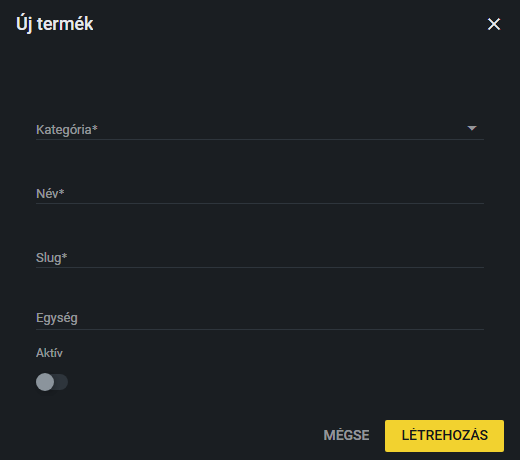

# Új termék felvétele

Új terméket a Termékek fülön tudsz létrehozni. A termék csak a „gyűjtő”: a konkrét, rendelhető változatokat (variációkat) és a képeket a létrehozás után kell hozzáadni.

## Hogyan veszek fel új terméket?

1. Nyisd meg a **Termékek** fület, és kattints az **Új termék** gombra.
2. Válaszd ki a **Kategóriát** (kötelező). Ha a listában előtte kategóriára szűrtél, az már ki van választva.
3. Írd be a termék **Nevét** (kötelező).
4. A **Slug** (kötelező) mezőt a rendszer automatikusan kitölti a névből, miközben gépelsz. Ha te magad átírod a slugot, onnantól már nem változtatja.
5. Az **Egység** mezőbe a mértékegységet írhatod (például db, m, csomag). Nem kötelező.
6. Az **Aktív** kapcsolóval döntheted el, hogy a termék látszódjon-e a weboldalon. Új termékeknél alapból ki van kapcsolva.
7. Kattints a **Létrehozás** gombra. (A **Mégse** semmit nem hoz létre.)

A létrehozás után a termék szerkesztő ablaka automatikusan megnyílik, hogy rögtön felvehesd a variációkat és a többi adatot. Erről itt olvashatsz: [Variációk és jellemzők](variaciok.md) és [Termék szerkesztése](termek-szerkesztese.md).

## Mi az a slug?

A slug a termék webcímének a része, például a `.../termekek/.../x-tray-mini` címben az `x-tray-mini`. Csak kisbetűt, számot és kötőjelet tartalmazhat, ezért a rendszer a névből ékezet nélküli, kötőjeles formát készít.

## Mikor jelenik meg a termék a weboldalon?

Csak az **aktív** termék jelenik meg a weboldalon. Az inaktív termék a weboldalon nem látható. Ezért érdemes az új terméket csak akkor aktívvá tenni, amikor az adatai és a variációi készen vannak. Az aktív/inaktív állapotot később a terméklistában is át lehet kapcsolni, lásd: [Termék szerkesztése](termek-szerkesztese.md).

> **Kiegészítendő:** Van-e szabály a termék nevének és slugjának formájára (például névadási konvenció, kis- és nagybetűk, a termékcsalád nevének szerepeltetése)? Ki dönti el, hogy melyik kategóriába kerül az új termék?
